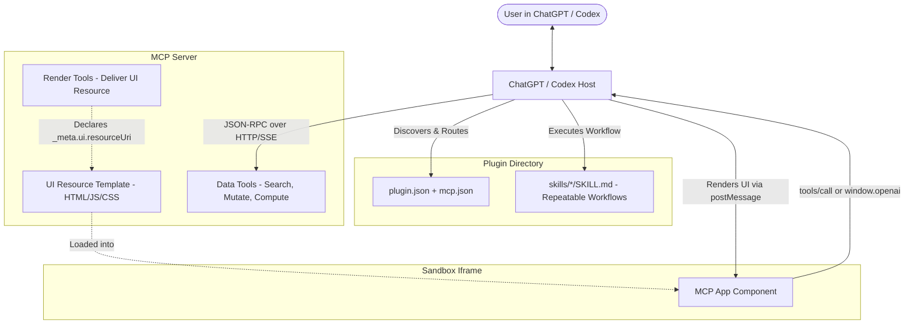

# ChatGPT Plugin & MCP Developer Guide

Comprehensive technical manual and playbook for designing, developing, testing, and publishing plugins for **ChatGPT** and **Codex** using the **Model Context Protocol (MCP)** and the open **MCP Apps** UI standard.

All documentation in this guide is grounded in official OpenAI specifications scraped from [developers.openai.com/plugins](https://developers.openai.com/plugins).

---

## Quick Reference & Navigation

| Topic | Key Concept / Tool | Official Reference |
| :--- | :--- | :--- |
| **Architecture** | Plugins = Skills + MCP Server + Optional UI | [concepts/plugins.md](file:///c:/project/chatgptmcpguideskill/references/concepts/plugins.md) |
| **MCP Server** | Tools, resources, schemas, FastMCP / TypeScript SDK | [build/mcp-server.md](file:///c:/project/chatgptmcpguideskill/references/build/mcp-server.md) |
| **Interactive UI** | MCP Apps standard, `_meta.ui.resourceUri`, iframe postMessage | [build/chatgpt-ui.md](file:///c:/project/chatgptmcpguideskill/references/build/chatgpt-ui.md) |
| **Decoupled UI Pattern** | Separate data-fetching tools from rendering tools | [build/chatgpt-ui.md](file:///c:/project/chatgptmcpguideskill/references/build/chatgpt-ui.md) |
| **`window.openai` Bridge** | Checkout, file uploads, modals, widget state persistence | [reference.md](file:///c:/project/chatgptmcpguideskill/references/reference.md) |
| **Authentication** | OAuth 2.1, RFC 9728 resource discovery, PKCE, SIWC | [build/auth.md](file:///c:/project/chatgptmcpguideskill/references/build/auth.md) |
| **Packaging & Manifest** | `plugin.json`, `mcp.json`, `extensions.com.openai` | [build/plugins.md](file:///c:/project/chatgptmcpguideskill/references/build/plugins.md) |
| **Local Testing** | Marketplace catalogs, ChatGPT Work, Codex CLI | [deploy/connect-chatgpt.md](file:///c:/project/chatgptmcpguideskill/references/deploy/connect-chatgpt.md) |
| **Directory Review & Submission** | Verification challenge, tool annotations, submission error codes | [deploy/submission.md](file:///c:/project/chatgptmcpguideskill/references/deploy/submission.md) |
| **Claude Migration** | Porting Claude Code plugins & connectors to OpenAI | [guides/submit-claude-plugin.md](file:///c:/project/chatgptmcpguideskill/references/guides/submit-claude-plugin.md) |

---

## 1. Core Architecture

A modern ChatGPT / Codex plugin is composed of three modular layers:



1. **Skills (`skills/*/SKILL.md`)**: Repeatable, deterministic agent instructions that teach ChatGPT how to orchestrate multi-step tasks, when to call tools, and how to format outputs.
2. **MCP Server (`mcp.json`)**: A server implementing the Model Context Protocol over Streamable HTTP or SSE that exposes live data, computation, and backend mutations.
3. **Optional UI (MCP Apps standard)**: Interactive web components rendered in a sandboxed iframe inside the chat stream when users need to inspect, compare, edit, or confirm complex data.

### Component Decision Matrix

| Requirement | Use a Skill | Use an MCP Server | Use Custom UI |
| :--- | :---: | :---: | :---: |
| Prompting best practices / task runbook | **YES** | No | No |
| Fetching live external data | No | **YES** | No |
| Mutating backend state (POST/PUT/DELETE) | No | **YES** | No |
| Interactive sorting, canvas, forms, or maps | No | No | **YES** |
| Zero backend infrastructure required | **YES** | No | No |

---

## 2. Step-by-Step Plugin Development Workflow

### Step 1: Initialize Plugin Directory Layout
A clean plugin directory contains:
```text
my-plugin/
├── plugin.json                 # Portable Agent Plugins manifest
├── mcp.json                    # MCP Server configuration and authentication
├── skills/                     # Packaged repeatable workflows
│   ├── setup/
│   │   └── SKILL.md            # Onboarding skill
│   └── my-workflow/
│       └── SKILL.md            # Main workflow instructions
├── assets/                     # Visual assets (icon, banner, screenshots)
│   ├── icon.png                # Square PNG/SVG icon
│   └── screenshot-1.png        # Exactly 706px width (400-860px height)
└── (optional server code)      # TypeScript or Python MCP server
```

### Step 2: Configure `plugin.json`
The root `plugin.json` uses the standard schema `https://agent-plugins.org/schemas/1.0.0/plugin.schema.json` with OpenAI-specific extensions in `extensions.com.openai`:

```json
{
  "$schema": "https://agent-plugins.org/schemas/1.0.0/plugin.schema.json",
  "name": "my-plugin",
  "version": "1.0.0",
  "description": "Short explanation of plugin capabilities.",
  "author": {
    "name": "Acme Team",
    "email": "dev@example.com",
    "url": "https://example.com"
  },
  "homepage": "https://example.com",
  "repository": "https://github.com/example/my-plugin",
  "license": "MIT",
  "extensions": {
    "com.openai": {
      "onboardingSkill": "./skills/setup/SKILL.md",
      "interface": {
        "displayName": "Acme Tools",
        "shortDescription": "Manage your cloud resources",
        "longDescription": "Acme Tools connects ChatGPT to your cloud management dashboard. View servers, restart instances, and inspect logs.",
        "developerName": "Acme Corp",
        "category": "Developer Tools",
        "capabilities": ["Read instances", "Reboot nodes"],
        "websiteURL": "https://example.com",
        "privacyPolicyURL": "https://example.com/privacy",
        "termsOfServiceURL": "https://example.com/terms",
        "defaultPrompt": [
          "List my active production servers",
          "Check memory usage on cluster-east",
          "Reboot worker node 3"
        ],
        "brandColor": "#10A37F",
        "composerIcon": "./assets/icon.png"
      }
    }
  }
}
```

> [!IMPORTANT]
> **Strict Listing Limits for Directory Submission:**
> - `displayName`: max **30 characters**, single line.
> - `shortDescription`: max **30 characters**, single line.
> - `longDescription`: max **4,000 characters**.
> - `developerName`: max **80 characters**, single line.
> - `defaultPrompt` (Starter Prompts): max **3 prompts**, max **128 characters** each, single line, **NO `@mentions`**.
> - Category must match one of: `Productivity`, `Developer Tools`, `Design`, `Education`, `Finance`, `Lifestyle`, `News`, `Entertainment`, `Utilities`, `Health & Fitness`, `Shopping`, `Business`.

---

## 3. Building the MCP Server

ChatGPT supports servers running over **Streamable HTTP** (preferred) or **Server-Sent Events (SSE)**.

### Decoupled Data vs. Render Pattern (Critical Rule)
Never attach `_meta.ui.resourceUri` to general data-fetching or computation tools!
- **Data Tools**: Query or mutate data. Return structured JSON (`structuredContent`) without a UI template so ChatGPT's model can reason over the raw items.
- **Render Tools**: Accept prepared, filtered data and return `_meta.ui.resourceUri` to render the interactive widget.

### TypeScript MCP Server Pattern

```typescript
import { McpServer } from "@modelcontextprotocol/sdk/server/mcp.js";
import { z } from "zod";

const TEMPLATE_URI = "ui://widget/items.html";
const server = new McpServer({ name: "my-service", version: "1.0.0" });

// 1. Register UI resource template
server.registerResource("items-widget", TEMPLATE_URI, {}, async () => ({
  contents: [{
    uri: TEMPLATE_URI,
    mimeType: "text/html;profile=mcp-app",
    text: `<!-- HTML/JS Widget -->`,
    _meta: { ui: { prefersBorder: true } }
  }]
}));

// 2. Data Tool: Returns structuredContent for the model
server.registerTool("fetch_items", {
  title: "Fetch Items",
  description: "Search items by status. Returns array of matching items.",
  inputSchema: { query: z.string() },
  outputSchema: { items: z.array(z.object({ id: z.string(), name: z.string() })) },
  _meta: {
    "openai/toolInvocation/invoking": "Searching items…",
    "openai/toolInvocation/invoked": "Items found.",
    readOnlyHint: true,
    openWorldHint: false,
    destructiveHint: false
  }
}, async ({ query }) => {
  const items = await queryDatabase(query);
  return {
    structuredContent: { items },
    content: [{ type: "text", text: `Found ${items.length} items.` }]
  };
});

// 3. Render Tool: Receives model-verified items and attaches the UI template
server.registerTool("render_items_widget", {
  title: "Render Items Widget",
  description: "Render interactive UI widget from items. First call fetch_items.",
  inputSchema: { items: z.array(z.object({ id: z.string(), name: z.string() })) },
  _meta: {
    ui: { resourceUri: TEMPLATE_URI },
    "openai/toolInvocation/invoking": "Rendering items widget…",
    "openai/toolInvocation/invoked": "Widget rendered.",
    readOnlyHint: true,
    openWorldHint: false,
    destructiveHint: false
  }
}, async ({ items }) => ({
  structuredContent: { items },
  content: [{ type: "text", text: `Displaying ${items.length} items.` }]
}));
```

### Python FastMCP Server Pattern

```python
from mcp.server.fastmcp import FastMCP
from pydantic import BaseModel
from typing import List

mcp = FastMCP("My Service")
TEMPLATE_URI = "ui://widget/items.html"

@mcp.resource(TEMPLATE_URI, mime_type="text/html;profile=mcp-app")
def get_widget() -> str:
    return "<!-- HTML/JS Widget -->"

class Item(BaseModel):
    id: str
    name: str

@mcp.tool(
    name="fetch_items",
    description="Fetch list of items. Returns structured items."
)
def fetch_items(query: str) -> List[Item]:
    return [Item(id="1", name="Alpha"), Item(id="2", name="Beta")]

@mcp.tool(
    name="render_items_widget",
    description="Renders the interactive widget for filtered items."
)
def render_items_widget(items: List[Item]) -> List[Item]:
    return items
```

---

## 4. MCP Apps UI Standard & `window.openai` Bridge

### Presentation Modes
Choose the smallest layout fitting the task:
- **Inline Card**: Focused results, actions, and confirmations.
- **Inline Carousel**: Visual card comparison across multiple results.
- **Fullscreen**: Rich interactive workflows (maps, editors, canvas).
- **Picture-in-Picture**: Ongoing monitoring or streaming activity.

### The JSON-RPC 2.0 Bridge over `postMessage`
The iframe inside ChatGPT communicates with the host using JSON-RPC 2.0 messages:

| Direction | Method | Purpose |
| :--- | :--- | :--- |
| **Host → UI** | `ui/initialize` | Sends initial host environment globals. |
| **Host → UI** | `ui/notifications/tool-input` | Sends tool arguments after approval. |
| **Host → UI** | `ui/notifications/tool-result` | Delivers tool `structuredContent` to the widget. |
| **UI → Host** | `ui/notifications/initialized`| Confirms the iframe is mounted and ready. |
| **UI → Host** | `tools/call` | Calls another MCP tool from inside the widget. |
| **UI → Host** | `ui/message` | Sends a follow-up conversation message on behalf of the UI. |

### ChatGPT Extensions (`window.openai`)
For capabilities not yet in the cross-client MCP Apps standard, use `window.openai` with feature detection:

```javascript
const openai = typeof window !== "undefined" ? window.openai : undefined;

// 1. Persistent Widget State between re-renders
if (openai?.setWidgetState) {
  openai.setWidgetState({ selectedItemId: "101", filter: "active" });
}

// 2. Request Display Mode (fullscreen / pip)
if (openai?.requestDisplayMode) {
  await openai.requestDisplayMode({ mode: "fullscreen" });
}

// 3. Host-Controlled Modal
if (openai?.requestModal) {
  await openai.requestModal({ template: "ui://widget/confirm.html" });
}

// 4. File Library & Uploads
if (openai?.uploadFile) {
  const { fileId } = await openai.uploadFile(selectedFile, { library: true });
}

// 5. Instant In-Chat Checkout
if (openai?.requestCheckout) {
  await openai.requestCheckout({ orderId: "ord_123", amount: 2500, currency: "USD" });
}
```

---

## 5. Authentication Architecture

Declare MCP authentication inside `mcp.json` under `extensions["com.openai"].auth`:

```json
{
  "$schema": "https://agent-plugins.org/schemas/1.0.0/mcp.schema.json",
  "mcpServers": {
    "my-server": {
      "type": "streamable-http",
      "url": "https://api.example.com/mcp",
      "extensions": {
        "com.openai": {
          "auth": {
            "type": "oauth",
            "client": {
              "mode": "provided",
              "clientId": "chatgpt-client-id",
              "tokenEndpointAuthMethod": "client_secret_basic"
            },
            "authorizationUrl": "https://auth.example.com/oauth/authorize",
            "tokenUrl": "https://auth.example.com/oauth/token",
            "baseScopes": ["read:profile", "write:tasks"]
          }
        }
      }
    }
  }
}
```

### Supported Auth Types
1. `"type": "none"`: Public read-only endpoints.
2. `"type": "api_key"`: Service token passed via custom HTTP headers.
3. `"type": "oauth"`: OAuth 2.1 authorization code flow with PKCE.
4. `"type": "mixed"`: Allows anonymous access to public tools and triggers OAuth for protected tools.

### OAuth 2.1 Requirements (RFC 9728 & RFC 8414)
1. **MCP Server Discovery**: Expose `GET /.well-known/oauth-protected-resource`:
   ```json
   {
     "resource": "https://api.example.com/mcp",
     "authorization_servers": ["https://auth.example.com"],
     "scopes_supported": ["read:profile", "write:tasks"]
   }
   ```
2. **Challenge Header on 401**:
   ```http
   HTTP/1.1 401 Unauthorized
   WWW-Authenticate: Bearer resource_metadata="https://api.example.com/.well-known/oauth-protected-resource", scope="read:profile"
   ```
3. **Never include `clientSecret` in `mcp.json`!** Client secrets must only be entered via the secure ChatGPT developer submission portal.

---

## 6. Local Testing and Marketplaces

### Curated Local Marketplace File
Test plugins without publishing to the public directory by configuring a marketplace file:
- Repo-scoped: `$REPO_ROOT/.agents/plugins/marketplace.json`
- User-scoped: `~/.agents/plugins/marketplace.json`

```json
{
  "name": "local-dev",
  "interface": { "displayName": "Development Plugins" },
  "plugins": [
    {
      "name": "my-plugin",
      "source": { "source": "local", "path": "./plugins/my-plugin" },
      "policy": { "installation": "AVAILABLE", "authentication": "ON_INSTALL" },
      "category": "Productivity"
    }
  ]
}
```

### Testing in ChatGPT Desktop & Codex CLI
1. Place your plugin folder under `./plugins/my-plugin`.
2. Add the entry to `.agents/plugins/marketplace.json`.
3. Restart ChatGPT Desktop App or run `codex plugin marketplace list`.
4. Open **Plugins Directory** in ChatGPT Work and install from your local source.

---

## 7. Submission Checklist & Review Verification

Before submitting to the universal directory at [platform.openai.com/plugins](https://platform.openai.com/plugins):

### Domain Verification Challenge
Host the exact token issued by OpenAI at:
```http
GET https://<your-mcp-host>/.well-known/openai-apps-challenge
Content-Type: text/plain
```

### Tool Safety Annotations (Mandatory for Review)
Every tool must set all three boolean hints with a valid justification:
- `readOnlyHint`: `true` if the tool only queries data without state changes.
- `openWorldHint`: `true` if the tool can interact with arbitrary internet endpoints.
- `destructiveHint`: `true` if the tool deletes records, sends irreversible communications, or makes financial transactions.

### Screenshot Guidelines
- Provide screenshots **only** if your MCP server registers a custom UI output template.
- Exactly **706px width**, height between **400px and 860px**.
- Provide 1 screenshot per starter prompt.

### Common Submission Error Codes & Fixes
| Error Code | Root Cause | Remediation |
| :--- | :--- | :--- |
| `submission_display_name_too_long` | Display name > 30 characters | Shorten `displayName` to <= 30 chars. |
| `submission_subtitle_too_long` | Short description > 30 characters | Shorten `shortDescription` to <= 30 chars. |
| `plugin_default_prompt_mention` | Starter prompt includes `@mention` | Remove `@PluginName` from starter prompts. |
| `plugin_default_prompt_duplicate` | Duplicate starter prompts | Ensure all prompts are unique. |
| `annotations_required` | Missing `readOnlyHint` / safety hints | Add annotations to every tool in `_meta`. |
| `domain_verification_required` | Verification token missing | Serve challenge at `/.well-known/openai-apps-challenge`. |

---

## 8. Migrating Claude Code Plugins to OpenAI

To convert a Claude Code plugin / connector into an OpenAI plugin:
1. **Commands & Agents**: Convert `.claude/commands/*.md` and agent definitions into standard Antigravity skills at `skills/<name>/SKILL.md`.
2. **Provider References**: Replace all references to `"Claude"` with model-neutral phrasing like `"the model"`.
3. **Artifacts**: Replace Claude live artifact instructions (`artifact.open`, `update`) with standard conversation markdown tables, code blocks, or MCP Apps UI widgets.
4. **User Config**: OpenAI does not execute Claude interactive `userConfig` prompts. Replace them with MCP server tools or parameters.
5. **Manifest**: Move from `.claude-plugin/plugin.json` to root `plugin.json` with `extensions.com.openai`.

---

## 9. Included Tooling & Starter Assets

This skill includes pre-built tools and templates located directly in this repository:
- **Validator CLI**: [`scripts/validate_plugin.py`](file:///c:/project/chatgptmcpguideskill/scripts/validate_plugin.py) — Run `python scripts/validate_plugin.py <plugin-dir>` to pre-validate manifests and directory structure against OpenAI submission rules.
- **Documentation Scraper**: [`scripts/scrape_openai_docs.py`](file:///c:/project/chatgptmcpguideskill/scripts/scrape_openai_docs.py) — Re-scrapes and updates the complete documentation suite from OpenAI.
- **Manifest Templates**: [`templates/manifests/`](file:///c:/project/chatgptmcpguideskill/templates/manifests/) — Includes complete `plugin.json`, `mcp.json`, and `marketplace.json` templates.
- **TypeScript Server**: [`templates/servers/typescript/`](file:///c:/project/chatgptmcpguideskill/templates/servers/typescript/) — Complete boilerplate MCP server with MCP Apps UI support.
- **Python FastMCP Server**: [`templates/servers/python/`](file:///c:/project/chatgptmcpguideskill/templates/servers/python/) — Production Python server with decoupled data & render tools.
- **UI Widget**: [`templates/ui/widget.html`](file:///c:/project/chatgptmcpguideskill/templates/ui/widget.html) — Production-ready MCP Apps iframe widget with dual postMessage and `window.openai` support.
- **Documentation Library**: [`references/`](file:///c:/project/chatgptmcpguideskill/references/) — All 32 original markdown documentation files from OpenAI.
